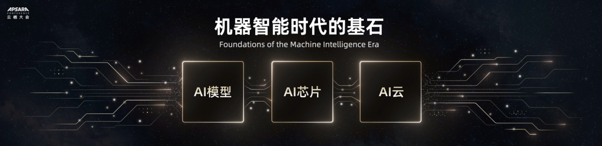

# 能力展示

`web-article-capture` 把网页正文、正文图片和来源可靠性说明整理成下游 Agent 可复用的 source package。这里展示从 2026-10-16 CCN 快报归档中选取的两组真实交付，共 20 张原始 PNG；演讲长文与技术图文各一组。

<a href="./showcase/20261016/review.html" target="_blank" rel="noopener noreferrer">打开完整图文展示：正文摘录、尾部、全部原图和完整 source.md</a>

| 示例 | 发布日期 / 采集日期 | 实际采集记录 | 原图 |
| --- | --- | --- | --- |
| 阿里云全栈 AI 路线图 | 2026-09-23 / 2026-10-16 | `rendered capture` | 11 张 PNG，均为 1200 px 宽 |
| 高通 AI-native 6G 平台 | 2026-05-29 / 2026-10-16 | `rendered capture (Codex in-app Browser)` | 9 张 PNG，均为 814 px 宽 |

展示页和原始 package 均保留在本 Skill 的公开资料中，不依赖临时目录。source.md 与图片保留采集归档的原始字节；本轮只整理和复核已有交付，没有重新执行网页抓取。采集模式、恢复步骤和边界判断以各包原有记录为准，结构校验通过不等于事实核验或独立抓取质量验收。

## 示例一：阿里云全栈 AI 路线图

原始页面来自 Alibaba Cloud Community，注明原作者为 Alizila Staff：[AliViews: Eddie Wu Shares Alibaba's Strategic Full-Stack AI Roadmap at the 2026 Apsara Conference](https://www.alibabacloud.com/blog/aliviews-eddie-wu-shares-alibabas-strategic-full-stack-ai-roadmap-at-the-2026-apsara-conference_603595)。



- <a href="/skill-static/web-article-capture/showcase/20261016/alibaba-roadmap-2026/source.md" target="_blank" rel="noopener noreferrer">打开原始 source.md</a>
- <a href="./showcase/20261016/review.html#alibaba-roadmap-2026" target="_blank" rel="noopener noreferrer">查看正文与 11 张原图</a>

该 package 保留演讲正文、11 张原图、原图 URL 及附近正文。从开场到致谢和 Alizila 原出处结束，记录排除了标签、分享、前后文章、推荐、评论和产品推广。图片数字 alt 来自原页面，补充的 Nearby text 用来解释图文关系，不冒充发布者图注。演讲中的预测和产品主张保持原有来源归属。

## 示例二：高通 AI-native 6G 平台

原始页面来自 Qualcomm OnQ Blog，作者为 Sunil Patil、Hemanth Sampath：[6G Foundry: Rewriting the mobile playbook for the AI era](https://www.qualcomm.com/news/onq/2026/05/6g-foundry-ai-native-platform)。


- <a href="/skill-static/web-article-capture/showcase/20261016/qualcomm-ai-native-platform/source.md" target="_blank" rel="noopener noreferrer">打开原始 source.md</a>
- <a href="./showcase/20261016/review.html#qualcomm-ai-native-platform" target="_blank" rel="noopener noreferrer">查看正文与 9 张原图</a>

该 package 保留 hero 与 Figure 1–8、原始图注、原图 URL 和相邻正文。正文止于最终架构总结段，排除 Go Deeper、newsletter、社交推广、作者头像及相关推荐；正文中嵌入的阅读列表保留。文章讨论架构目标与早期实验，缺少完整数值测试条件，不应据此宣称标准要求或保证商业性能。

两包均通过 `validate_capture_package.py --require-images when-referenced`，20 张图片均可解码，展示页可打开原尺寸文件。<a href="/skill-static/web-article-capture/showcase/20261016/provenance.json" target="_blank" rel="noopener noreferrer">公开来源与文件清单</a>记录图片数量、尺寸、原始 URL 和 SHA256，便于核对归档内容。

## 交付形态

每个抓取页面输出一个独立目录：

```text
<output-root>/<source-slug>/
  source.md
  images/
```

`source.md` 记录页面来源、抓取时间、正文内容、正文图片、原始图片 URL、图注、抓取模式和可靠性说明。`images/` 保存正文实际引用的原始图片资产。用户按需要求的 `review.html` 是汇总检查面，不放进单页 package 内。

## 覆盖能力

- 抓取文章、官方文档、博客、公告或媒体丰富页面的正文。
- 为 PPT、研究、资料整理或后续 Agent分析准备可追踪来源包。
- 保留正文图片、图表、图注和附近文本的对应关系。
- 记录 Browser 受阻阶段、部分抓取、官方来源 fallback 和媒体不确定性。
- 通过 validator 发现 package 结构、引用和疑似截图文件名问题。

## 能力边界

- 不把整页截图当作 source package，也不把截图放进 `images/` 冒充原始正文图片。
- 不保留导航、页脚、推荐、评论、联系卡片、社交组件或装饰图，除非正文明确讨论它们。
- 不绕过登录、访问控制或站点限制；页面持续受阻时应明确降级和风险。
- validator 只检查目录和引用等结构约定，不解码图片或验证来源元数据，也不证明正文完整、图片语义正确或来源事实真实。
- 页面无正文图片时可以保留空 `images/`，但必须说明可见媒体是不存在还是因不属于正文而被排除。
