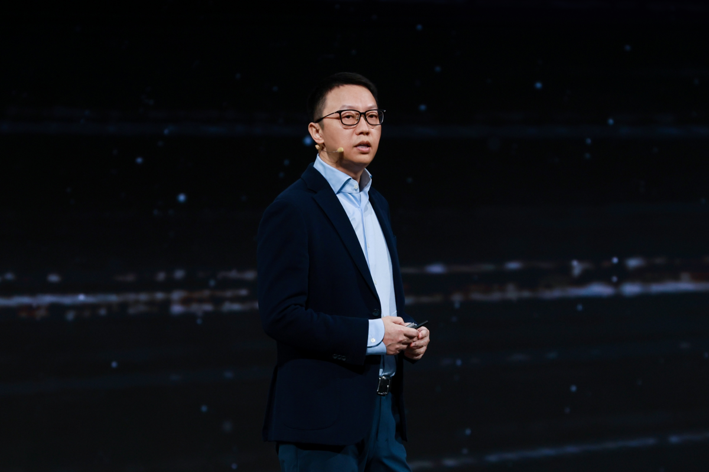
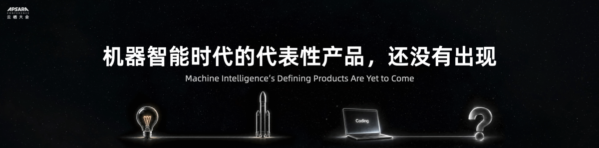
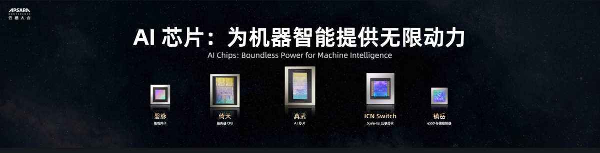

# AliViews: Eddie Wu Shares Alibaba's Strategic Full-Stack AI Roadmap at the 2026 Apsara Conference

Source URL: https://www.alibabacloud.com/blog/aliviews-eddie-wu-shares-alibabas-strategic-full-stack-ai-roadmap-at-the-2026-apsara-conference_603595

Publisher: Alibaba Cloud Community; original publisher: Alizila

Author: Alizila Staff

Published: September 23, 2026; keynote delivered September 22, 2026

Captured: 2026-10-16 (Asia/Shanghai)

## Capture notes

Capture mode: rendered capture. Codex in-app Browser fresh-tab retry successfully rendered the complete article after initial navigation timeout. DOM scope: `.wrap-main-left-article.markdown-body`; source HTML was serialized after rendered DOM inspection and verified against all 11 rendered original image URLs. Original image bytes downloaded directly from these verified URLs.

Boundary: full article from keynote hero through closing thanks and original Alizila attribution. Tags, sharing, previous/next, recommendations, comments, author profile and related products excluded. Tail audited in rendered DOM.

Media: 11 inline original PNGs kept (1200 px width); no uncertain body media. Numeric alt labels are original; contextual nearby text is supplied below, not represented as publisher captions.

## Article

Alibaba unveils its full-stack AI infrastructure roadmap to lead the coming era of "Machine Intelligence."

Original image URL: https://yqintl.alicdn.com/fc3a4133d49f4745ebd3f44d55d7fb01fb3964f5.png

Original alt: 1. Nearby text: Apsara Conference, Alibaba Cloud’s annual flagship event, kicked off on Sept. 22, 2026 in Hangzhou. __ Eddie Wu, CEO of Alibaba Group __, delivered a keynote speech sharing the company’s perspective of the “Machine Intelligence” era and its strategic roadmap forward.

Apsara Conference, Alibaba Cloud’s annual flagship event, kicked off on Sept. 22, 2026 in Hangzhou. __ Eddie Wu, CEO of Alibaba Group __, delivered a keynote speech sharing the company’s perspective of the “Machine Intelligence” era and its strategic roadmap forward.

Distinguished guests, leaders and developers, welcome to the 2026 Apsara Conference.

A year ago, we saw AGI as merely the starting point — AI would continue advancing toward self-iterating Artificial Superintelligence (ASI). Over the past year, the paradigm of “vibe coding” has rapidly matured into full-spectrum “vibe working”. At the same time, AI has achieved decisive breakthroughs in long-horizon task execution, bringing the technological roadmap toward autonomous evolution into focus.

Original image URL: https://yqintl.alicdn.com/bf5a9ededfbcbb50f7f1d24b7e2a6f3b2ce873fd.png

Original alt: 2. Nearby text: As AI unlocks greater capabilities and penetrates into every domain, a profound shift is underway: machines are becoming the primary force behind Thinking, turning intelligence into a commodity supplied at scale.

As AI unlocks greater capabilities and penetrates into every domain, a profound shift is underway: machines are becoming the primary force behind Thinking, turning intelligence into a commodity supplied at scale.

The Industrial Revolution produced a comparable transformation, when power became a mass commodity. Humanity invented steam engine, internal combustion, and electricity—and built the modern industrial world around them.

Now Thinking is following the same path. Historically, the cognitive bandwidth applied to any complex challenge was constrained by two hard ceilings: the limits of human intelligence and the economic allocation of capital. Today, machines are systematically shattering both barriers. As ASI takes shape and AI infrastructure scales up, Thinking will become as abundant and accessible as power— and the era of “Machine Intelligence” will have truly begun.

What brings us together today is our perspective on this era of “Machine Intelligence”, and the strategic bets Alibaba is placing to lead it.

Original image URL: https://yqintl.alicdn.com/3bd487f7f0d2928c30c993fec806308538156f34.png

Original alt: 3. Nearby text: First, I want to clarify a concept.

First, I want to clarify a concept.

We have been calling this technology “Artificial Intelligence”. But artificial simply means man-made—like lab-grown diamonds or synthetic leather. We frame AI through the lens of human beings, hoping to build machines that think like us. In the early days, the ultimate questions were always: “Does it sound human?” and “Can it pass the Turing Test?”

Look back at the Industrial Revolution. Steam and combustion engines were designed merely to do what horses and laborers were already doing: pumping water, weaving, and hauling. That’s why the term “horsepower” exists.

But very quickly, the machine outgrew the biology it copied. Because no amount of physical labor could ever build a train, launch an airplane, or reach deep space.

Machine power created an entirely new order of capability, enabling humanity to achieve what had once been impossible .

Likewise, Machine Intelligence today is not a substitute for human intelligence, but an entirely different species. Generating code or writing reports? That is intelligence in its infancy. When Machine Intelligence becomes unlimited in supply, its impact on society will extend far beyond the automation of existing cognitive work . Yet the shift we are witnessing today runs even deeper than the Industrial Revolution ever did.

We have two views about the era of Machine Intelligence .

Original image URL: https://yqintl.alicdn.com/9cc78729c97c47799a9f436be96e2aef8385670a.png

Original alt: 4. Nearby text: First, machines will produce over 1,000 times more Thinking than all of humanity combined.

First, machines will produce over 1,000 times more Thinking than all of humanity combined.

This has already happened in the physical world. Today, machine power already drives 99.9% of the world’s physical work. In the future, the total amount of Human Thinking will continue to grow, but Machine Thinking will expand even faster, ultimately shouldering 99.9% of all Thinking .

On the supply side, top-tier Human Thinking is extremely limited . Cultivating a single world-class scientist or expert demands time, talent, and no small measure of luck. Therefore, research in many fields remains under invested.

Take neonatal progeria, for example. Only a few dozen new cases are diagnosed worldwide each year, with just a few hundred living patients on record. Rare diseases like this almost never receive the research resources they deserve. Under the economic logic of today’s pharmaceutical industry, few companies can justify investing over a decade of time and billions of dollars into developing a drug for only a few hundred people.

All of that changes when AI reaches the intellectual bar for specialized research and computing power becomes cheap and abundant. Researchers in any domain could deploy millions of agents working around the clock to simulate, validate, and explore entirely new hypotheses. Underfunded fields will, for the very first time, gain access to massive cognitive capacity. Top-tier Thinking will go from a rare luxury to a commodity available at scale . Just imagine: in the future, every niche domain will have millions of AI scientists and domain experts constantly driving breakthroughs and tackling challenges. Consider how profoundly that will reshape the fabric of human society.

On the demand side , consider the Industrial Era: the volume of goods humans could consume was bounded by population. Coffee needs someone to drink it; cars need drivers; phones need users. The physical products one person can consume in a lifetime are finite.

But as AI grows ever more capable, this dynamic changes fundamentally. Picture this: We ask AI to build a starship to Mars. For such an ultra-complex, long-horizon task, AI will break it down into tens of millions of subtasks, executed by millions of agents working non-stop until completion. A human only needs to define the intent and the goal to mobilize massive intellectual resources. Every “super individual” gains 10,000x intellectual leverage. The demand for Thinking will no longer scale with population, but with the depth of Machine Intelligence. The total volume of Machine Thinking will far surpass that of Human Thinking.

Today, the total volume of Machine Thinking is less than 3% of all Human Thinking. If that volume eventually scales to 1,000x human capacity, the simple math tells us: Machine Thinking still has an enormous growth runway.

Original image URL: https://yqintl.alicdn.com/30540d4785c09af391b99826373dc89691df3a95.png

Original alt: 5. Nearby text: Second, the truly groundbreaking products of the Machine Intelligence era have not yet arrived.

Second, the truly groundbreaking products of the Machine Intelligence era have not yet arrived.

Consider the early days of electricity: It was initially used only for lighting. In 1882, when Thomas Edison switched on the Pearl Street Station, it powered barely four hundred lightbulbs across a few blocks. Interestingly enough, in the beginning, Edison bundled light bulbs with free electricity, much like how AI agent platforms give away free tokens today.

But the inventions that fundamentally changed human life were born much later. Air conditioning appeared in 1902; washing machines and refrigerators entered households years after that. And the first digital computer didn’t arrive until 1946—over six decades after those 400 lamps. Of course, in the age of AI, this evolutionary clock is running exponentially faster.

AI coding is simply the light bulb of the Machine Intelligence era. It automates existing human work—traditional programming. As AI expands deeper into the corporate workplace, we must remember: merely automating existing work will never define a new era.

Standing beneath those first electric streetlights in 1882, no one could have envisioned the full scope of the electrical age. Similarly, it is nearly impossible for us today to predict the new products or breakthrough inventions that will follow once Machine Intelligence truly takes off.

But one thing remains clear: no matter what those future inventions look like, the journey always starts with infrastructure—building power plants and laying grids. By around 1900, many electrical devices had begun finding their way into households. But the world’s entire annual electricity output back then would power our world today for barely two hours .

Original image URL: https://yqintl.alicdn.com/5a1b6f7e82c0193ded2014a7c2d732aa808e2ad0.png

Original alt: 6. Nearby text: In the age of Machine Intelligence , powerful infrastructure is equally non-negotiable, and rests on three cornerstones: AI models, AI chips, and the AI cloud. Together, they form the foundation for delivering Machine Thinking at scale. Only when AI infrastructure is truly comprehensive and advanced will breakthrough products and novel inventions flourish across the application landscape.

In the age of Machine Intelligence , powerful infrastructure is equally non-negotiable, and rests on three cornerstones: AI models, AI chips, and the AI cloud. Together, they form the foundation for delivering Machine Thinking at scale. Only when AI infrastructure is truly comprehensive and advanced will breakthrough products and novel inventions flourish across the application landscape.

Parallel to the historic rollout of electricity, the demand for AI infrastructure in the era of Machine Intelligence is practically limitless. Alibaba remains committed to building this core infrastructure across AI models, AI chips and the AI cloud as a long-term strategic priority.

Original image URL: https://yqintl.alicdn.com/5b783f34c88e6066cc5d7b21e8dd6f876bf383f2.png

Original alt: 7. Nearby text: The first cornerstone is the AI model . Last year, we discussed AI moving from autonomous action to self-iteration. This year, the technical pathway toward Artificial Superintelligence (ASI) has become increasingly clear.

The first cornerstone is the AI model . Last year, we discussed AI moving from autonomous action to self-iteration. This year, the technical pathway toward Artificial Superintelligence (ASI) has become increasingly clear.

From coding and productivity to scientific research, models are tackling more real-world tasks. These real-world challenges and feedback make models significantly more capable.

AI researchers have also mapped out a concrete path forward: Recursive Self-Improvement (RSI). By engaging with real-world tasks and feedback, models identify their own limitations. They autonomously design experiments, synthesize data, and evaluate outcomes, driving a continuous cycle of self-evolution. Currently, Alibaba’s Qwen team is exploring RSI and has made meaningful progress. The team is continuing to advance research on model architecture and data optimization, and plans to train a new model at the scale of 5 to 10 trillion-parameter, with the goal of completing more complex, longer-horizon tasks and advancing toward ASI.

But if building foundation models is about forging an ultra-intelligent, self-evolving brain, then multimodal capability is the other vital frontier of Machine Intelligence .

Yet, a powerful brain alone is not enough; AI must also master perception and interaction . Humans connect and communicate intentions and emotions through voice, visuals, facial expressions, and gestures. Models need profound multimodal abilities to comprehend and communicate these signals and align with human culture, aesthetics, and values. Looking ahead, people will interact with AI as naturally as they do with fellow human beings, without the friction of complex interfaces. Only then can AI truly and meaningfully serve humanity. Therefore, multimodal models that unify understanding and generation are another core research direction for us.

Original image URL: https://yqintl.alicdn.com/1d8a0611654cc7989c932f9dc2231a9bf37b3574.png

Original alt: 8. Nearby text: The second cornerstone is the AI chip. If tokens are the electricity powering the AI era, then chips are the power plants. In the upcoming age of Machine Intelligence , demand for tokens will be virtually boundless, requiring chips to continuously enhance performance and scale supply.

The second cornerstone is the AI chip. If tokens are the electricity powering the AI era, then chips are the power plants. In the upcoming age of Machine Intelligence , demand for tokens will be virtually boundless, requiring chips to continuously enhance performance and scale supply.

Today, T- Head is building a comprehensive portfolio of data center chips: the “Zhenwu” series for GPU chips, the “Yitian” series for CPU chips, the “Panmai” series for smart NICs, and ICN interconnect chips. The portfolio fully covers the core chips required to build ultra-large-scale AI clusters.

Meanwhile, we are driving end-to-end co-optimization spanning chips, servers, supernodes, networks, models, and inference engines, systematically maximizing the token throughput and cost efficiency of our AI cluster infrastructure. Alibaba’s proprietary M890 AI Supernode already delivers high-efficiency inference for foundation models above 2 trillion parameters, positioning us among a handful of companies globally with this tier of capability. Starting this quarter, Alibaba Cloud is bringing our AI Supernodes online at true commercial scale.

At Apsara Conference, we are introducing our next-generation AI chip, the Zhenwu V900. It is the most powerful AI chip in China today, delivering three times the performance of its predecessor, the Zhenwu M890. A single cluster built on V900 can support up to 500,000 cards to power frontier model training and inference. Backed by the proven maturity of T-head product lines and widespread adoption across our clients, we anticipate a significant growth in the annual AI chip shipment volumes.

Looking ahead, intelligence should be everywhere and AI is moving aggressively into the desktop and mobile environments.

On the desktop, our open-source Qwen-27B has emerged as the most popular model among developers worldwide. We will continue refining these models, giving developers and enterprises the power to deploy high-performance intelligence locally. For mobile devices, we are officially launching Qwen Intelligence. It is an end-to-end solution built for our partners, enabling mobile devices to reason through and execute truly complex tasks.

Original image URL: https://yqintl.alicdn.com/c59232a3407cc84de391625b29eb7be1a27c9ffd.png

Original alt: 9. Nearby text: The third cornerstone is the AI cloud. If chips generate tokens, the cloud is the grid that delivers them wherever they are needed.

The third cornerstone is the AI cloud. If chips generate tokens, the cloud is the grid that delivers them wherever they are needed.

Models require continuous training and inference, agents are running long-horizon tasks, and AI-developed software is multiplying rapidly. All of them will become “residents” on the cloud, constantly consuming compute. We must architect an AI cloud purpose-built for these emerging workloads.

Today, we hardly ever notice the electrical grid itself. Wherever we go, we plug into a socket, and the power flows instantly. Without the grid and the outlet, modern life would be unbearable for even twenty-four hours. In the future, accessing Machine Intelligence should ultimately become as effortless as flipping a light switch: plug into the cloud, and intelligence is on tap—anytime, anywhere.

Achieving this demands a hyper-scale, globally distributed infrastructure that co-optimizes the entire stack—spanning GPUs, CPUs, network, storage, databases, and essential tools. As this network matures, it will attract and sustain an expanding ecosystem of users and autonomous agents, creating massive compounding network effects.

Currently, customer demand for AI remains exceptionally robust, and we are mobilizing every resource to provision AI compute and meet our clients’ needs, driving accelerating Alibaba Cloud’s revenue growth. However, we recognize that the industry’s mid-to-long-term demand far outpaces our supply capabilities. Global shortages across the AI data center supply chain are currently limiting the speed at which we can scale our compute infrastructure.

Original image URL: https://yqintl.alicdn.com/c8943f2e6c41aa57da24e72467acc38af44bd251.png

Original alt: 10. Nearby text: In response, Alibaba will join forces with all our partners to commit fully to AI infrastructure development, forging an AI cloud designed for the Machine Intelligence era. Our target is that by 2032, the global data center capacity operated by Alibaba Cloud will surpass 20GW, fueling the industry’s exponentially rising demand for AI.

In response, Alibaba will join forces with all our partners to commit fully to AI infrastructure development, forging an AI cloud designed for the Machine Intelligence era. Our target is that by 2032, the global data center capacity operated by Alibaba Cloud will surpass 20GW, fueling the industry’s exponentially rising demand for AI.

As machines become the primary engines of Thinking , what transformations lie ahead?

Let history be our guide. When the Industrial Revolution transferred physical toil to machines, humans were liberated from grueling labor. We didn’t stop moving, instead, we developed modern sports. The Olympic Games, the World Cup, the NBA—these were all born in the wake of the industrial age.

History repeats this pattern time and again. The rise of printing sparked an explosion of human literature. Photography didn’t destroy painting; it freed painters from chasing realism and gave birth to impressionism and abstract art.

When machines shoulder more of what must be done, humans will have the time to pursue what they truly desire to do. Looking ahead, Machine Intelligence will unlock unprecedented space for human curiosity and creativity. Just as a farmer working in the fields three centuries ago could scarcely imagine that people would one day pay to perform physical exertion in a “gym,” we, too, find ourselves constrained in fully capturing the landscape of what lies ahead.

Original image URL: https://yqintl.alicdn.com/3d70f3356c09bece08c46ea8c4b0552ad06685fa.png

Original alt: 11. Nearby text: Last year, we asserted that the more capable AI becomes, the more powerful humanity will be. Today, I remain steadfast in that conviction. This defines the ultimate purpose of our commitment to the era of Machine Intelligence: to offload onerous tasks to machines while preserving time, creativity, and the appreciation of life’s beauty for humanity.

Last year, we asserted that the more capable AI becomes, the more powerful humanity will be. Today, I remain steadfast in that conviction. This defines the ultimate purpose of our commitment to the era of Machine Intelligence: to offload onerous tasks to machines while preserving time, creativity, and the appreciation of life’s beauty for humanity.

All of this is only just beginning.

I wish you all an enriching and enjoyable Apsara Conference. Thank you very much.

---

This article was originally published on Alizila written by Alizila Staff.

Original link: [Alizila](https://www.alizila.com/aliviews-eddie-wu-shares-alibabas-strategic-full-stack-ai-roadmap-at-the-2026-apsara-conference/)
