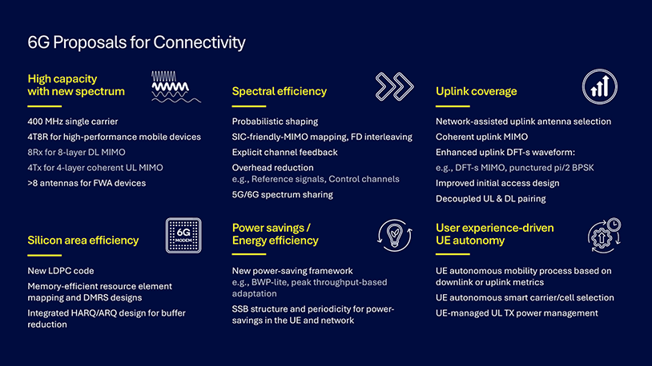
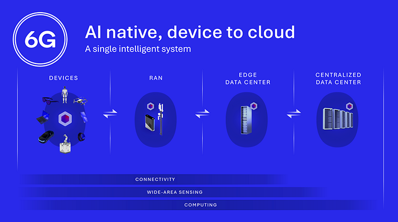
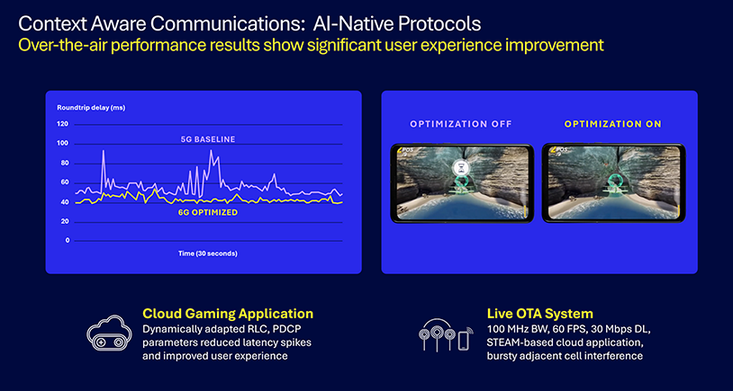
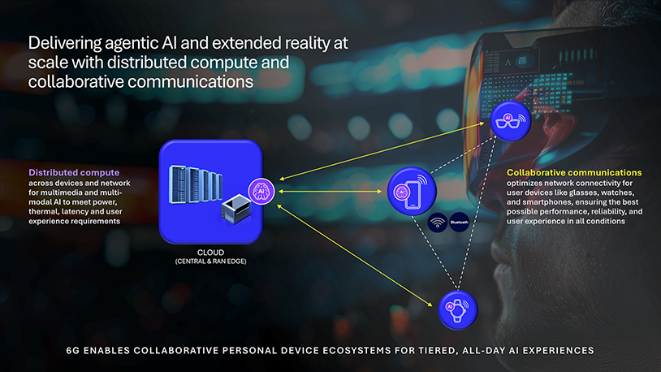
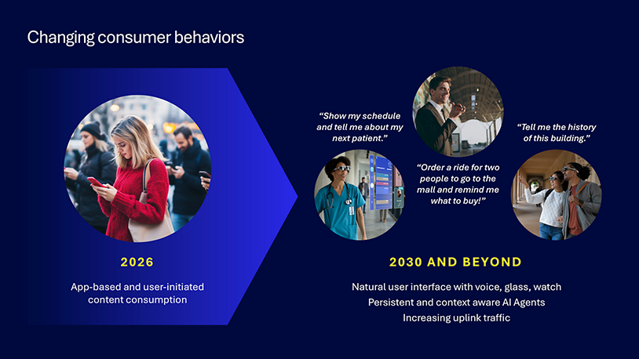
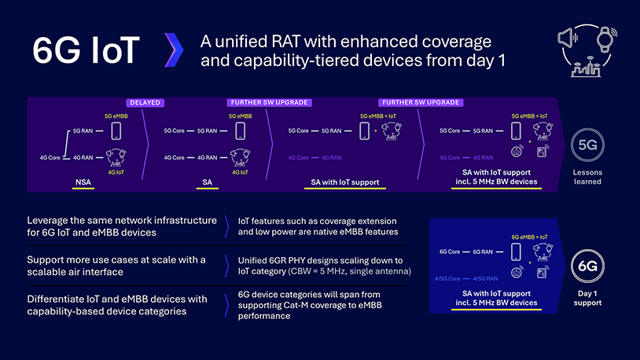
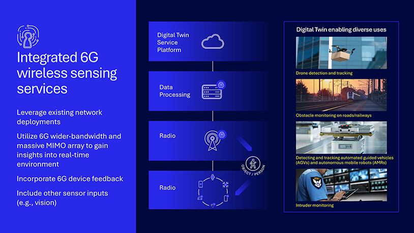
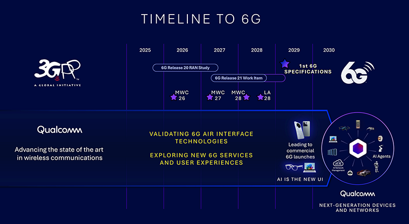

# 6G Foundry: Rewriting the mobile playbook for the AI era

- Source URL: https://www.qualcomm.com/news/onq/2026/05/6g-foundry-ai-native-platform
- Publisher: Qualcomm OnQ Blog
- Published: May 29, 2026
- Authors: Sunil Patil; Hemanth Sampath
- Captured: 2026-10-16 (Asia/Shanghai)
- Capture mode: rendered capture (Codex in-app Browser)

Original image URL: https://s7d1.scene7.com/is/image/dmqualcommprod/6g-foundry-ai-native-platform?$QC_Responsive$&fmt=png-alpha&wid=814

Caption / nearby text: Article hero below title; introduces the AI-native 6G platform.

## What you should know

- 6G is being designed with coverage, uplink performance, spectral efficiency and energy efficiency as first order goals. Wider contiguous spectrum, targeted uplink gains and more efficient device and network operation form the baseline required to support future AI driven services at scale.
- Beyond connectivity, 6G integrates distributed compute and wide-area sensing as core capabilities. AI native architectures across device, RAN and Core enable context aware operation, dynamic QoS and real time adaptation to application intent.
- With 6G, agentic AI, immersive XR, multi-device collaboration and sensing-based services become viable on the move, and Qualcomm Technologies is helping advance 6G development and commercialization. With standards work underway, pre commercial validation later this decade and early deployments around 2030, 6G is progressing with execution realism.

6G goes beyond wireless evolution to power an AI-native future. 6G begins by strengthening what matters most: reliable, efficient wireless connectivity everywhere it is needed. Unlike prior generations that emphasized peak downlink rates, 6G explicitly targets uplink performance, cell edge coverage and power efficiency, reflecting how traffic patterns are evolving in an AI-driven world.

AI agents and sensing-rich devices generate more uplink-heavy, continuous and autonomous traffic than traditional user-initiated applications. To support this shift, 6G air interface design focuses on improved uplink link budget, more efficient waveforms, advanced MIMO and longer effective transmission opportunities. These changes aim to deliver multi dB uplink coverage improvements while reducing power consumption at both the device and network level.

Spectrum strategy is equally foundational. 6G emphasizes large contiguous channels, enabling higher capacity, simpler scheduling, improved energy efficiency and better support for sensing.

### 6G Foundry: Explore the next generation of wireless connectivity with Qualcomm Technologies experts.

- [Read Part 9 — Air-interface innovations for always-on AI at scale](https://www.qualcomm.com/news/onq/2026/01/6g-giga-mimo-subband-full-duplex-ai)
- [Watch interviews with our experts at MWC Barcelona 2026 by RCRtv](https://www.youtube.com/playlist?list=PLwHfYh9uobIvwqpn_3EPZXvlKu834Mlb7)

A single wideband carrier is more efficient than aggregating many narrow ones, benefiting both network economics and device design.

Just as important, 6G is being designed to avoid fragmentation. Rather than introducing IoT or reduced-capability variants years after launch, the goal is a unified air interface that scales from low-bandwidth, low-power devices to high-performance broadband from day one. This simplifies deployment and ensures the network can support diverse use cases without incremental architectural churn.

Original image URL: https://s7d1.scene7.com/is/image/dmqualcommprod/6G-proposals-for-connectivity?$QC_Responsive$&fmt=png-alpha&wid=814

Caption: Figure 1. Support future AI driven services at scale with a strong 6G connectivity foundation.

## Architect the air interface for capacity, efficiency and user-centric performance

Designing the 6G air interface centers on scaling capacity without sacrificing wide-area performance or system simplicity. New spectrum enables very wide single-carrier operation, paired with advanced multi-antenna configurations that scale across smartphones and fixed wireless access devices. High-order downlink and uplink MIMO, extended transmit and receive chains, and antenna-rich device designs are being explored to unlock higher throughput while maintaining a unified, non-fragmented air interface. In parallel, spectral efficiency remains a first-order objective. Techniques such as probabilistic shaping, interference-aware MIMO mapping, frequency-domain interleaving and explicit channel feedback are combined with streamlined reference signals and control overhead to extract more value from every hertz, including in 5G/6G spectrum sharing scenarios.

Equally important, 6G strengthens uplink robustness, device efficiency and user-centric operation. Network-assisted uplink antenna selection, coherent uplink MIMO, and enhanced DFT-s waveforms improve uplink reliability, particularly at the cell edge, while more flexible initial access and uplink-downlink pairing increase deployment robustness. Beneath the air interface, new LDPC codes, memory-efficient signal designs, and integrated HARQ/ARQ concepts target [reductions in silicon area and buffering requirements](https://www.qualcomm.com/news/onq/2025/08/6g-foundry-next-air-interface-more-capable-connected-future). These gains are reinforced by system-level power-saving frameworks, optimized synchronization signaling and adaptive bandwidth operation to reduce energy consumption across devices and networks. Together with user experience-driven UE autonomy with network-defined guardrails, spanning mobility decisions, latency, reliability and ordering parameters, smart carrier selection and uplink power, these principles translate architectural rigor into scalable, real-world connectivity improvements.

Original image URL: https://s7d1.scene7.com/is/image/dmqualcommprod/AI-native-device-to-cloud?$QC_Responsive$&fmt=png-alpha&wid=814

Caption: Figure 2. Create a single intelligent system that spans the device, network, edge and cloud with 6G.

## Evolve connectivity into a platform: connectivity, compute and sensing

With a stronger wireless foundation, 6G expands the role of the network from transport to platform. Connectivity remains essential, but it is complemented by distributed compute and wide-area sensing as native capabilities. Converging these three pillars into one system marks the essential shift from 5G to 6G. Together, they transform the network into an intelligent, perceptive platform, capable of supporting services that go well beyond data transport. We look at distributed compute and wide-area sensing in more detail later after setting the stage with an AI-native architecture.

Original image URL: https://s7d1.scene7.com/is/image/dmqualcommprod/Context-aware-communications?$QC_Responsive$&fmt=png-alpha&wid=814

Caption: Figure 3. Use AI-native protocols for context-aware communications to improve experiences with demanding use cases.

## AI-native network architectures

Delivering this converged platform requires a fundamental architectural shift. [6G is being designed as an AI-native, context-aware or intent-aware platform](https://www.qualcomm.com/news/onq/2026/02/mwc-barcelona-2026-prototyping-ai-native-6g-services) with intelligence embedded across device, RAN and core.

On-device intelligence can infer application type and user experience in real time, enabling adaptive behavior that better matches current communication needs. Devices can derive application and user experience context by classifying traffic flows with on-device AI, observing hardware and software signatures and leveraging proximity to application logic.

This enables UE-autonomous adaptation of protocol and radio parameters within the guardrails prescribed by the network. Early experimentation shows that such adaptation can significantly reduce latency spikes and improve consistency for interactive applications.

In addition, context-aware operation allows devices to share information about real-time user experience, context complexity and dynamically varying application QoS to the network. The network can then adapt scheduling, resource allocation, QoS and protocol behavior in real time. This enables timely handling of short-lived, bursty AI traffic, sensing data and other latency-sensitive flows.

Crucially, orchestration is not assigned to a single entity. Devices, networks and application ecosystems collaborate, exchanging context through standardized interfaces. The result is a system that optimizes for latency, power and experience outcomes rather than fixed configurations.

Original image URL: https://s7d1.scene7.com/is/image/dmqualcommprod/Collaborative-communications?$QC_Responsive$&fmt=png-alpha&wid=814

Caption: Figure 4. Gain coverage, capacity and battery life with distributed compute and collaborative communications.

## Distribute compute and collaborative communications

Distributed compute recognizes that AI inference cannot live exclusively in centralized cloud infrastructure. Latency, power, privacy and reliability constraints require dynamic placement of workloads across devices, edge infrastructure and centralized resources. 6G is designed to support this flexibility, enabling operators to host compute closer to users and creating opportunities for new in-network services.

In 6G, multiple personal devices like phones and wearables like glasses can act as a coordinated system rather than isolated endpoints. Multi-device collaborative communications can improve wearable performance by mitigating inherent device constraints such as a limited number of antennas, bandwidth, thermal headroom and battery capacity. For example, by enabling complementary communication paths through a companion device, the system can improve robustness to head and body shadowing and improve reliability, coverage and latency.

Distributed computing further complements this approach by allowing workloads such as rendering, perception and interference modeling to run either on-device or be offloaded to edge or cloud resources. When network conditions are favorable, offloading can provide access to larger models and higher-fidelity experiences while reducing device power consumption, though it increases network demand and sensitivity to latency and congestion. When connectivity degrades, workloads can shift back to on-device execution to preserve responsiveness, albeit with higher local power consumption.

Field experiments with distributed compute and collaborative communications already [demonstrate gains in coverage, capacity and battery life](https://www.qualcomm.com/news/onq/2025/09/empowering-ai-user-experiences-with-6g), reinforcing this architectural direction.

Original image URL: https://s7d1.scene7.com/is/image/dmqualcommprod/Changing-consumer-behaviours?$QC_Responsive$&fmt=png-alpha&wid=814

Caption: Figure 5. Prepare for AI-enhanced, heads-up lifestyles with 6G technology and network architecture.

## Enable new AI-driven and immersive user experiences

These foundations and architectures ultimately enable new classes of user experiences. Agentic AI moves interaction from episodic and app-centric to continuous and context-aware. Devices observe, infer and act with minimal user prompting, driving sustained uplink traffic and tighter latency requirements.

Immersive XR benefits from the same capabilities. Distributed compute allows lightweight devices to access powerful inference and rendering when available, while collaborative communications improve reliability and performance in dense or mobile scenarios.

These experiences are not treated as speculative endpoints. They directly inform 6G design assumptions regarding traffic, power, coverage and architecture to ensure that the system is built for how networks will be used over the next decade and beyond.

Original image URL: https://s7d1.scene7.com/is/image/dmqualcommprod/6G-IoT?$QC_Responsive$&fmt=png-alpha&wid=814

Caption: Figure 6. Scale IoT from day one with a unified radio access network.

## Build one network for IoT and eMBB from day one

Instead of introducing IoT support through delayed architectural transitions or network-wide software upgrades, 6G is envisioned to launch as a standalone system with native IoT support on day one, including devices operating on as little as 5 MHz bandwidth. A single, scalable radio access technology enables eMBB and IoT devices to share the same network infrastructure, with features such as coverage extension and low-power operation treated as inherent capabilities of the air interface rather than bolt-on modes.

Unified physical-layer designs are being explored that can scale seamlessly from single-antenna, narrow-band IoT devices to high-performance broadband platforms, while capability-based device categories allow differentiation without fragmenting the system. This approach allows 6G device classes to span a wide performance range, from Cat-M-like coverage to full eMBB throughput, while simplifying deployment, accelerating adoption and ensuring the network is ready to support massive IoT growth from the very first release.

Original image URL: https://s7d1.scene7.com/is/image/dmqualcommprod/Sensing?$QC_Responsive$&fmt=png-alpha&wid=814

Caption: Figure 7. Grow beyond connectivity using RF sensing for new capabilities from a common network infrastructure.

## Extend the network with wide-area sensing

Wide-area sensing extends the network’s capability further in 6G. By leveraging wide bandwidths and large antenna arrays, 6G radios can act as sensors that detect objects, movement and environmental context as part of normal operation. Combined with device sensors and analytics, this enables digital representations of the physical world, opening new classes of enterprise, industrial and public-sector applications. Rather than deploying separate sensing infrastructure, 6G leverages existing cellular deployments to observe the physical environment.

Radio-based sensing enables applications such as object detection, tracking and environmental awareness at scale. 6G enables both monostatic and multi-static sensing at both the gNodeB and device, with wider bandwidths as well as support for new waveforms. Early field testing has shown that sensing-enabled infrastructure is able to reliably detect drones and vehicles at long ranges from the base-station. When combined with device inputs and analytics, sensing capabilities support digital twins that reflect real-world conditions in near real time.

Because sensing is integrated into the air interface, it benefits from the coverage, reliability and security properties of connectivity infrastructure. This integration allows operators to offer sensing-based services using familiar equipment and operations, extending the value of the network without duplicative systems.

Original image URL: https://s7d1.scene7.com/is/image/dmqualcommprod/Timeline?$QC_Responsive$&fmt=png-alpha&wid=814

Caption: Figure 8. The 3GPP ecosystem is standardizing 6G now for commercial launch around 2030.

## Sequence the path to commercialization

6G development follows a deliberate, staged path. Study and definition work is underway, with formal specifications expected in 2029. Pre-commercial trials will validate air-interface performance, sensing, AI-native operation and distributed compute before large-scale deployment. Commercial introduction is expected around 2030, with adoption varying by operator strategy and market conditions.

Some will move quickly to enable AI driven services; others will progress more cautiously. The common thread is that not investing does not resolve the structural pressures on networks created by AI era demand.

By focusing early on fundamentals, architecture and realistic execution, Qualcomm Technologies is architecting 6G for the AI era — positioned to deliver durable value technically and economically across the ecosystem.

## Capture notes

The article-body AEM container was inspected in the rendered DOM. Capture stops after the concluding Qualcomm architecture paragraph and before Go Deeper research-hub/newsletter/social promotional modules. Excluded author avatars, related articles, site navigation and footer. Kept the hero and all eight numbered figures in original article order. Image URLs are original page image assets, not page screenshots. Embedded reading-list text is preserved. Typography whitespace and nonbreaking hyphens were normalized when writing Markdown. The publisher presents architectural goals and early experiments; most gains have no numerical test conditions in this article. Do not interpret them as standardized requirements or guaranteed commercial performance.
